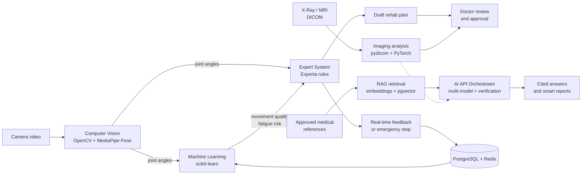

# FAITH in LIFE

> **AI-powered remote physiotherapy platform** — computer vision, machine learning, an expert system, and retrieval-augmented generation (RAG), with a doctor always in the loop.

A semester project at the Faculty of Informatics Engineering, Syria (academic year 2026–2027). The repository currently contains the **analysis and design documentation** (use cases, narratives, activity and sequence diagrams, ERD, and the AI algorithms design). The Arabic documentation follows below.

---

## نبذة عن المشروع

**FAITH in LIFE** منصة محلية ذكية للعلاج الفيزيائي عن بُعد (*Local Intelligent Rehabilitation Platform*). تساعد المريض على إكمال علاجه من البداية حتى التعافي من منزله، وتمنح الطبيب والمرافق رؤية موضوعية لتقدم الحالة، باستخدام الذكاء الاصطناعي لتتبع الحركة وتصحيحها لحظياً وتخصيص الخطة العلاجية.

## المشكلة التي يحلها

- ارتفاع كلفة الجلسات العلاجية وكثرتها، وصعوبة الالتزام بالتمارين المنزلية دون إشراف.
- خوف المريض من أداء التمرين بشكل خاطئ وإيذاء نفسه، وصعوبة فهمه للمصطلحات الطبية.
- عدم قدرة الطبيب على معرفة مدى التزام المريض، واعتماده على تقييم حركي تقديري وغير موضوعي.
- قلق المرافق عند غياب وسيلة سهلة لمتابعة المريض أو تلقي إنذار عند حدوث طارئ.
- صعوبة نقل ملف المريض وتاريخ علاجه عند تغيير الطبيب.

## المزايا الرئيسية

- **مراقبة ذكية وتغذية راجعة فورية:** تتبع حركة المريض من الكاميرا، وحساب زوايا المفاصل ومقارنتها بالمجال الآمن الذي يعتمده الطبيب، وتصحيح مرئي وصوتي بالعربية بتأخير أقل من ثانية. لا يُفعَّل التصحيح إلا إذا استمر الخطأ نحو ثلث ثانية، لتجنب التنبيهات المزعجة.
- **خطط علاجية مخصصة:** تراعي العمر والجنس والإصابة ومستوى الألم والعمل والأمراض المرافقة وموانع الاستطباب، وتُعرَض على الطبيب كمسودة ولا تُفعَّل إلا بعد اعتماده.
- **الإنذار السريري المبكر:** إيقاف طارئ للجلسة وإنذار للمرافق والطبيب عند علامات الخطر، وإشعار الأخصائي عند تراجع المؤشرات الحركية.
- **واجهات متعددة المستخدمين:** واجهة بسيطة للمريض، ولوحة تحكم شاملة للطبيب، ومراقبة وتنبيهات للمرافق.
- **استفسارات طبية موثقة (RAG):** إجابات مبنية على مراجع معتمدة فقط مع ذكر المصدر، والرفض عند عدم كفاية المراجع بدل التخمين.
- **تحليل الصور الشعاعية:** قراءة ملفات DICOM وفحص جودتها وتقديم ملخص أولي داعم للقرار وليس تشخيصاً نهائياً.
- **تقارير ذكية وتحفيز:** تقارير يومية وأسبوعية وشهرية حسب نوع المستخدم، ونقاط ومكافآت لتشجيع الالتزام.
- **السجل الطبي الإلكتروني وإدارة النظام:** سجل جلسات وتقدم سريري، وإشعارات، ونسخ احتياطي مجدول، وحوكمة وصلاحيات.

## المستخدمون (Actors)

| الفاعل | الدور في النظام |
|---|---|
| **المريض** | تنفيذ الجلسات أمام الكاميرا وتلقي التصحيح، ورفع الصور الشعاعية، وطرح الاستفسارات، ومتابعة التقارير والنقاط |
| **أخصائي العلاج الفيزيائي / الطبيب** | اعتماد الخطط وتصحيحها، ومراجعة الصور والمؤشرات، واقتراح القواعد السريرية، وتلقي الإنذارات |
| **مرافق المريض** | تلقي الإنذارات الفورية والملخصات الأسبوعية ومتابعة الالتزام |

## معمارية الذكاء الاصطناعي

يعتمد النظام على أربعة مكونات ذكية تتكامل معاً، ويتولى **مدير واجهات الذكاء الاصطناعي** تعزيز الجانب اللغوي والتحليلي عبر عدة نماذج مع التحقق من المصدر:

| المكوّن | الدور | أهم المكتبات |
|---|---|---|
| **الرؤية الحاسوبية** | التقاط الفيديو وتقدير الوضعية وحساب زوايا المفاصل وتحليل الصور الشعاعية | OpenCV, MediaPipe, pydicom, PyTorch |
| **التعلم الآلي** | تصنيف جودة الحركة، كشف الإرهاق، كشف التراجع، التنبؤ بخطر الانتكاس | scikit-learn, pandas, SciPy |
| **النظام الخبير** | تطبيق القواعد السريرية المعتمدة لقرارات السلامة والتصحيح وتخصيص الخطة | Experta |
| **نظام الاسترجاع (RAG)** | الإجابة الموثقة من المراجع المعتمدة | sentence-transformers, pgvector, LangChain, Ollama |

**مبدأ تصميمي أساسي:** القرارات التي تمس السلامة (المجال الزاوي الآمن، الإيقاف الطارئ، موانع الاستطباب) تُتخذ بقواعد صريحة في النظام الخبير، ولا تُترك لنموذج لغوي أو نموذج تعلم آلي وحده. النماذج اللغوية للاسترجاع والصياغة فقط، وكل مخرج طبي حساس يبقى مسودة حتى يعتمده الطبيب.

للتفاصيل الكاملة (الخوارزميات خطوة بخطوة، والمكتبات، وكيفية تكامل كل خطوة مع السابقة واللاحقة) راجع الملف [`FAITH_in_LIFE_AI_Algorithms_Explained.docx`](docs/AI/FAITH_in_LIFE_AI_Algorithms_Explained.docx).

## التقنيات المستخدمة

| الطبقة | التقنيات |
|---|---|
| **الواجهة الأمامية** | React 18 + Vite، React Three Fiber وThree.js (الهيكل ثلاثي الأبعاد)، Tailwind CSS، Recharts، i18next |
| **الخادم** | Python 3.11+، FastAPI، SQLAlchemy، Alembic، python-socketio |
| **الرؤية والصور الطبية** | MediaPipe، OpenCV، pydicom، scikit-image، Cornerstone (عرض DICOM) |
| **التعلم الآلي والنظام الخبير** | PyTorch، scikit-learn، Experta |
| **الاسترجاع واللغة** | sentence-transformers، pgvector، FAISS / ChromaDB، LangChain، Ollama / llama-cpp-python |
| **قواعد البيانات والتخزين** | PostgreSQL 16 + pgvector، Redis، تخزين ملفات محلي أو MinIO |
| **التقارير** | Jinja2، ReportLab |
| **الأدوات** | Docker Desktop، JupyterLab، Postman، Figma، Cursor، Jira (إدارة المهام)، GitHub (الملفات والبرمجيات) |

## الوثائق والمخططات

| الوثيقة | المحتوى |
|---|---|
| `docs/Faith in LIFE Diagrams` | تحوي جميع مخططات المشروع |
## محتويات docs/Faith in LIFE Diagrams  : 
1. الصورة الكلية لل use case للنظام بالكامل .
2. مجلدات فرعية ( كل مجلد يحتوي على SubSystem من النظام بالكامل ) .
 كل مجلد فرعي من ال SubSystem يحتوي على : 
1. مجلدات فرعية لكل ال use case ضمن ال SubSystem نفسه . 
2. صورة جزئية من ال Use case الكامل الخاصة بهذا الجزء من ال SubSystem.  
كل مجلد فرعي ل use case معينة ضمن المجلد الفرعي لل SubSystem يحتوي على : 
1. Narrative 
2. Activity Diagram
3. System Sequence Diagram 

## حالة المشروع

المستودع حالياً في مرحلة **التحليل والتصميم**: المقترح، ومخططات UML، وتصميم قاعدة البيانات، وتصميم الخوارزميات الذكية. يُحدَّث هذا القسم مع بدء التنفيذ.

بعض مكونات الذكاء الاصطناعي (تصنيف جودة الحركة، كشف الإرهاق، التنبؤ بخطر الانتكاس، تحليل الصور) تحتاج بيانات مصنّفة بإشراف أخصائيين للتدريب والتحقق، وستبدأ كنماذج أولية أو كقواعد وعتبات صريحة إلى أن تتوفر البيانات.

## التشغيل والتثبيت

> سيُضاف هذا القسم عند اكتمال أول نسخة قابلة للتشغيل.

## الأمان والخصوصية

- بيانات المرضى حساسة: يُخطَّط لتشفيرها أثناء النقل والتخزين، ولمصادقة متعددة العوامل وصلاحيات بحسب الدور.
- فيديو المريض وتتبع الحركة يُعالجان محلياً ولا يُرسلان إلى أي خدمة خارجية.
- مفاتيح واجهات الذكاء الاصطناعي تُحفظ في متغيرات البيئة أو Secrets Manager، **ولا تُرفع إلى GitHub إطلاقاً**.
- أي بيانات طبية تُرسل إلى خدمة خارجية تُجهَّل هويتها أولاً وبموافقة المريض.

## تنبيه طبي

هذا المشروع **أكاديمي لأغراض التعلم**، وليس جهازاً طبياً معتمداً. مخرجاته (تصحيح الحركة، تحليل الصور، التنبؤات، الإجابات) داعمة للقرار فقط، ولا تغني عن تقييم الطبيب أو الأخصائي المختص ولا تُعد تشخيصاً.

## الفريق والإشراف

- **أعضاء المشروع:** دانا نزار شارقه الملقب بالحجار، نبراس نورس دعبول
- **المشرفة:** المهندسة إيليسار حسن بري
- **الجامعة:** جامعة الشام الخاصة — كلية الهندسة المعلوماتية
- **العام الدراسي:** 2026 – 2027

